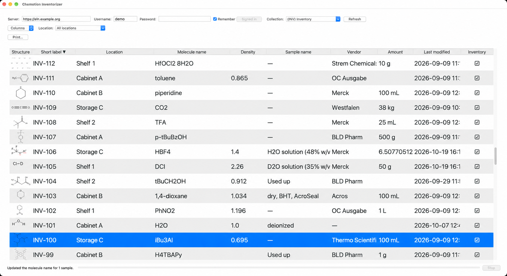
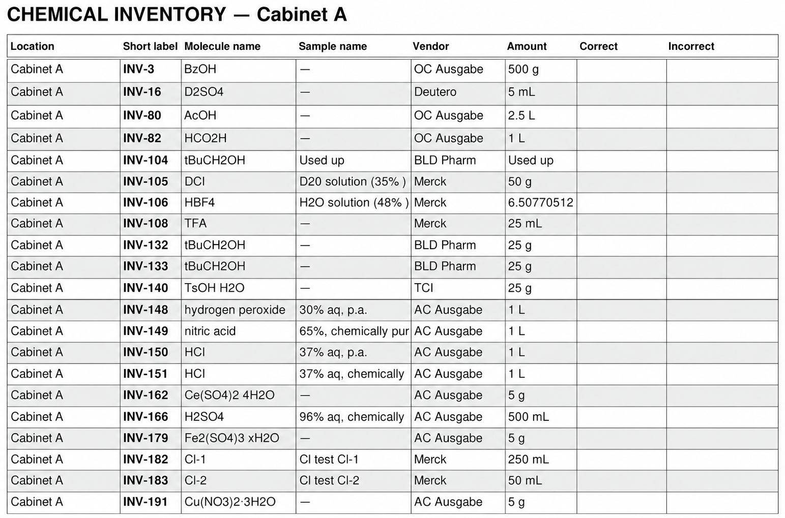

# Chemotion Inventorizer

Chemotion Inventorizer is a desktop app for viewing, bulk-editing, and printing Chemotion sample information.



*Inventory view with molecule structures and sample details. Identifying text has been anonymized.*

## Features

- Browse collection inventories in a customizable table with molecule structures and sample details.
- Sort by column and filter by location.
- Edit sample details individually or in bulk directly in Chemotion.
- Remove samples from a collection without deleting them from Chemotion.
- Open samples in Chemotion for further inspection.
- Create A4 PDF checklists for inventory verification.
- Export collections as ZIP archives.

## Supported environments

- macOS 11+ (Intel or Apple Silicon).
- Windows 10+ (64-bit Intel/AMD).

## Setup

- **Standalone app:** Ready to use without installing Python.
- **Customizable launcher:** Runs the editable Python source and requires Python 3.10+. Choose this option to customize the app.

### Standalone app

1. Download the ZIP for your platform from [Releases](https://github.com/Kenichi-Endo/chemotion-inventorizer/releases): **macos-apple-silicon**, **macos-intel**, or **windows-x64**.
2. Extract the ZIP and open the app.
3. On macOS, dismiss the verification warning, then open **System Settings → Privacy & Security → Open Anyway** and confirm.
4. On Windows, when **Windows protected your PC** appears, select **More info → Run anyway**.

### Customizable launcher

1. Install Python 3.10+, if not installed: [Python for macOS](https://www.python.org/downloads/macos/) or [Python for Windows](https://www.python.org/downloads/windows/). On Windows, select **Add python.exe to PATH** and keep **tcl/tk and IDLE** selected during installation.
2. Download **Source code (zip)** from [Releases](https://github.com/Kenichi-Endo/chemotion-inventorizer/releases) and extract it, or clone the repository. Keep the project folder intact when moving or sharing the app.
3. Open `Chemotion Inventorizer.app` on macOS or double-click `Chemotion Inventorizer.cmd` on Windows. Keep an internet connection available during automatic dependency installation. The first launch may take a few minutes.

If macOS says **“Chemotion Inventorizer.app” cannot be opened**:

1. Open Terminal, type `cd ` (including the space), drag the extracted project folder into Terminal, and press Return.
2. Run:

   ```sh
   chmod +x "Chemotion Inventorizer.app/Contents/MacOS/Chemotion Inventorizer"
   ```

3. Reopen the app.

### Common setup
1. Enter the Chemotion server root URL (for example, `https://eln.example.org`), your username, and password, then select **Sign in**.
2. Choose a collection.
3. Use **Columns** to choose visible columns. Drag column headings to reorder them, or click a heading to sort.
4. Adjust **Font size** and **Structure size**.

## Use
- Launch the app.
- If you need only the newest samples, press Esc to stop loading samples.
- To filter entries by location, select **Location**.
- To edit one sample, click a cell. For **Location**, an existing location can be chosen from the dropdown. For **Amount**, include a unit such as `250 mg`. Press (Shift+)Return/Enter or Tab to save directly to Chemotion and move to the next cell, or Esc to cancel.
- To edit multiple samples, use Command/Ctrl-click to select multiple samples, or Shift-click to select a range. Edit a cell in the selection to apply the value to all selected rows.
- To check or edit a sample in Chemotion, double-click a structure or short label.
- To remove a sample from the collection, press Delete key.
- To check an inventory, click **Print…** to create an A4 checklist. Choose the columns and their order, page grouping, and optional **Correct** and **Incorrect** check columns.
- To export a collection, click **Export collection…**. You can continue working while **Export queued** is shown; keep the app open until the completion dialog appears. This can be useful as a backup. Synchronized collections cannot be exported.



*A4 inventory checklist with verification columns. Locations have been anonymized.*

## Customization
Edit the Python files in `src/chemotion_inventorizer/` manually or with a coding agent, then restart the customizable launcher.

## Data handling

Sample information is retrieved over HTTPS and held in memory while the app is open.

With **Remember** enabled, your username and password are saved locally in macOS Keychain or Windows Credential Manager under `io.github.kenichi-endo.chemotion-inventorizer`.

Server and display preferences are saved separately in the current user's profile:

- macOS: `~/Library/Application Support/Chemotion Inventorizer/settings.json`
- Windows: `%APPDATA%\Chemotion Inventorizer\settings.json`

Customizable launcher logs are in `~/Library/Logs/Chemotion Inventorizer/launcher.log` on macOS or `%LOCALAPPDATA%\Chemotion Inventorizer\Logs\launcher.log` on Windows.

## Source files
Files in `src/chemotion_inventorizer/`:

| Source file | Purpose |
| --- | --- |
| `__init__.py` | Package identity and application name. |
| `__main__.py` | Module and installed-command entry point; starts the GUI. |
| `gui.py` | Window, table, dialogs, cell editing, and structure thumbnails. |
| `client.py` | Chemotion sign-in, inventory retrieval, sample updates, and collection export. |
| `inventory.py` | Inventory rows, column definitions, amount and date formatting, sorting, and location filtering. |
| `settings.py` | Saved preferences, column and print settings, and secure credential storage. |
| `printing.py` | PDF checklist layout and generation. |
| `bootstrap.py` | Customizable launcher environment and dependency setup. |
| `standalone.py` | Standalone app entry point and dependency checks. |

## License

This project is licensed under the [MIT License](LICENSE).
